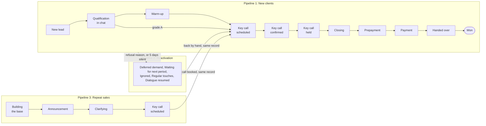

# Salesforce sales pipeline

A written sales-process brief, turned into a working Salesforce setup: three pipelines, eight automations
and five access roles, with every requirement proven by an automated test.

[](https://github.com/i-teamcollage/salesforce-sales-pipeline/actions/workflows/checks.yml)


> A working sample by [I-Team Collage](https://iteamcollage.com). The company in the brief, Quorvale
> Academy, is made up, and so is every deal in the tests. Nothing in this repository comes from a client.

## What it is

Most sales teams do not need a new CRM. They need the one they have to follow their process. That process
usually lives in a document: the stages a deal goes through, what must be filled in before it moves on,
what should happen by itself, and who may see what.

[The brief](docs/brief.md) is that document, for a school that sells cohort-based programs. It asks for
three pipelines, 23 fields, eight automations, five roles and an hourly Google Sheets dashboard. This
repository builds it in Salesforce. Each requirement has an id, and the tests that prove it carry the same
id, so you can follow any rule from the brief to the configuration to its test
([traceability](docs/traceability.md)).



## Results

The acceptance test was written before the build: 100% of the brief's requirements proven by a passing
test, 100% of the Apex tests passing in a real Salesforce org, at least 90% of the Apex code covered, and
100% of the metadata checks passing.

<!-- results:start -->
| Criterion | Target | Measured | 95% interval | Result |
|---|---|---|---|---|
| Brief requirements implemented with a passing test | = 100% | n/a |  | FAIL |
| Apex tests passing in a real Salesforce org | = 100% | n/a |  | FAIL |
| Apex code covered by tests | ≥ 90% | n/a |  | FAIL |
| Metadata conformance checks passing | = 100% | 100.0% | 97.0–100.0% | PASS |

71 made-up test cases.
<!-- results:end -->

The Apex tests have not run in an org yet. The org used for this build turned out to be a 30-day trial
edition that does not allow Apex at all, so the three org figures stay "n/a" until the run is stored
(`make org-test` in a Developer Edition). Everything that edition does allow was deployed to it: the
pipelines, fields, validation rules, flows, permission sets and layout. Full results, per requirement, are
in [reports/acceptance.md](reports/acceptance.md).

## How the brief maps to Salesforce

| The brief asks for | In Salesforce |
|---|---|
| Three pipelines | Three Opportunity record types, each with its own sales process (stage list) |
| Moving between pipelines keeps the same deal | The record type changes on the same record; tests check that the Id and the source survive |
| Lists, never free text | Restricted picklists; sources, segments, objections and refusal reasons are shared global value sets |
| A deal cannot move on with empty required fields | One validation rule per stage, reading a stage-order formula |
| Eight automations | Four record-triggered flows (A2, A3, A6, A7) and Apex for the rest (A1, A4, A5, A7's daily job, A8) |
| Settings without code | Custom Metadata: days of silence, payment terms per method, UTM-to-source mapping |
| Five roles | Private sharing, one permission set per role, two criteria-based sharing rules |
| An hourly Google Sheets dashboard | Apps Script: a Raw sheet of deals and a Dashboard sheet of formulas |

## What the brief review found

A brief always has gaps. [The brief review](docs/brief-review.md) lists 27 questions a consultant would
ask, each with the assumption we took. Three examples:

- The brief says 5 fields fill in by themselves, but its own table marks 7. We automated all 7.
- It asks for a target date for the full payment but gives no rule. The rule is a setting per payment
  method, which the head of sales can change without code.
- The dashboard wants CPL and CAC, which need ad spend, and ad spend is not in the CRM. The spreadsheet
  gets one "Ad spend" sheet until a client build imports it.

## Install it in your own Salesforce

You need an org that allows Apex and custom metadata: a free
[Developer Edition](https://developer.salesforce.com/signup), or a sandbox of an Enterprise or Unlimited
org. Trial editions such as Starter refuse Apex.

1. Install the [Salesforce CLI](https://developer.salesforce.com/tools/salesforcecli) and log in:
   `sf org login web --alias my-org`.
2. Check the stage list. [`OpportunityStage`](force-app/main/default/standardValueSets/OpportunityStage.standardValueSet-meta.xml)
   keeps Salesforce's current default stages next to the brief's. If your org uses other stages, add them
   to that file first, so the deploy does not switch them off.
3. Know what changes: Opportunity sharing becomes Private, so people see only their own deals plus what
   the roles below grant. Other opportunities are never touched by the automations or the stage rules.
4. Deploy and test:
   ```bash
   git clone https://github.com/i-teamcollage/salesforce-sales-pipeline
   cd salesforce-sales-pipeline
   make deploy ORG=my-org      # sf project deploy start
   make org-test ORG=my-org    # runs the Apex tests and stores the run in reports/
   make accept readme          # rebuilds the report and the table above
   ```
5. Set up the people. Give each user the "Minimum Access - Salesforce" profile and the permission set of
   their role (Head of sales, Owner, Closer, Chat manager, Assistant). Add chat managers to the public
   group "Chat managers" and assistants to "Assistants". A permission set cannot take away a right a
   profile grants, which is why the profile is the minimal one.
6. Switch on the parts that live in Setup:
   - schedule the daily silence check once: `echo "SilentDealsJob.scheduleDaily();" | sf apex run --target-org my-org`;
   - enable Web-to-Lead with the chat manager as the default lead creator, and put
     [the form](web-to-lead/application-form.html) on the website;
   - assign the "Sales Pipeline Layout" to the three record types.

## The Google Sheets export

[`google-sheets/`](google-sheets/) holds an Apps Script that reads every deal through the Salesforce REST API,
at least once an hour and on demand. It writes a "Raw" sheet, one row per deal with the brief's 25
columns, and builds a "Dashboard" sheet of formulas in 8 blocks: the month's funnel, conversion rates, by
closer, by chat manager, unprocessed leads, enrollment forecast, sources with CPL and CAC, refusal
reasons. It never writes back. The setup takes about ten minutes: [google-sheets/README.md](google-sheets/README.md).

## How it is tested

| Where | What it proves |
|---|---|
| [Apex tests](force-app/main/default/classes/) | 56 test methods in 13 classes, each named after the requirement it proves, such as `A4_slotLessThanThreeHoursAheadIsRejected`. They create made-up leads and deals, run the automations, and check what each role can see and do with `System.runAs`. |
| [Static checks](tests/) | Python reads the metadata XML: stage lists, field types, a validation rule for every gated field, permission sets without Delete or Export for the restricted roles, the sharing rules. |
| [Node tests](google-sheets/transform.test.js) | The export's row mapping and every dashboard formula, checked against made-up deals. |
| [Traceability](docs/traceability.md) | Generated from the brief and the tests. CI fails if any requirement loses its last test. |

GitHub runs the static checks, the Node tests and the traceability rule on every change
([checks.yml](.github/workflows/checks.yml)). It has no Salesforce org, so it rebuilds the report from
the stored org run.

## What a client build adds

- Messenger and telephony integrations (chat history, call recordings).
- Payment status synced from the payment platform.
- Migration of the client's current deals.
- Ad-spend import for CPL and CAC.
- Team training, which the brief excludes.

## About the data

Quorvale Academy, its people, leads and deals are fictional, and any resemblance is a coincidence. The
brief is our own English rewrite of a sample CRM brief, adapted to Salesforce. The lists of sources,
objections and refusal reasons are placeholders that a client replaces with their own.

---

Built by [I-Team Collage](https://iteamcollage.com): workflow automation for finance, operations and
support teams in Europe, accepted only when it passes a test your own people wrote.
[Book a free 30-minute call](https://calendly.com/dorsa-maskouki/i-team-collage).

Licensed under the [MIT License](LICENSE).
